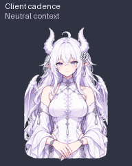

# GPT娘

一位白发紫瞳、带有龙角与淡紫龙翼的原画风半身伙伴。动作设计以安静眨眼、小幅颔首和克制的手势为主，注重清晰的轮廓与自然的相邻姿态，举止儒雅端庄。适用于支持 Pets 的 ChatGPT Work 环境。

**[领养 GPT娘](https://chatgpt.com/s/sharepet_6ad9cc9be0548191b707c78f5fa5a964)** · **[下载精灵图](assets/gpt-niang-spritesheet.png)** · **[下载发布包](https://github.com/Jerryhhhhhh/gpt-niang-pet/releases/latest)**



主预览模拟一次触发后的实际客户端节奏：三轮小幅动作，然后回到慢速待机；GIF 文件本身只播放一次。

## v1.1 更新

- 颔首更浅；思考时双手保持腰前，不再反复抬手托腮。
- 收小移动、致意、等待和检查动作，九组动作的首尾休止帧保持一致。
- 从原始图像一次缩放到最终格子，减少二次采样；待机人物的有效高度由约 176 增至 194 像素，原生格子尺寸仍为 192×208。
- 提供内容区为 512×555 的源分辨率细节预览（含标题的 GIF 画布为 512×603）。它保留源图像素，不是把 192 像素成品放大，也不能作为 Pets 精灵图上传。

[颔首前后对照](previews/comparison-courteous-nod.gif) · [思考前后对照](previews/comparison-thinking.gif)

## 使用

在已启用 Pets 的对话中发送：

```text
请领养并选用这个宠物：
https://chatgpt.com/s/sharepet_6ad9cc9be0548191b707c78f5fa5a964
```

领养会在你的宠物库中创建自己的副本。无需运行安装脚本；也可以下载 [PNG 精灵图](assets/gpt-niang-spritesheet.png)，交给兼容该格式的工具使用。可用性取决于客户端是否支持并启用了 Pets。

## 动作

| 状态 | 表现 |
| --- | --- |
| 安静待机 | 轻眨眼，双手交叠 |
| 向右移动 | 朝右转身，从容移动 |
| 向左移动 | 朝左转身，发梢与龙翼轻微跟随 |
| 抬手致意 | 手留在腰侧，轻转掌心后收回 |
| 轻颔首致意 | 垂眸、小幅颔首后恢复平视，双手和身体保持稳定 |
| 轻微关切 | 目光微垂，短暂收敛表情后恢复 |
| 耐心等待输入 | 在腰侧轻开掌心，邀请回应 |
| 专注思考 | 双手交叠，以细微目光变化表现专注 |
| 检查与确认 | 保持头部稳定，细微扫视检查 |

另外包含 **16 个顺时针注视方向**，由眼睛与头颈共同表现，腰线保持稳定。

原先的跃起动作已替换为下面这组**轻颔首致意**。为兼容精灵图格式，`pet.json` 中零基索引为 `4` 的动作行（第 5 行）仍使用内部状态名 `jumping`，但实际画面没有腾空跳跃。


## 更多预览

- [全部九组动画 GIF](previews/all-states.gif) / [MP4](previews/all-states.mp4)
- [16 方向环视](previews/look-loop.gif) / [方向检查图](previews/look-directions.png)
- [全部帧总览](previews/contact-sheet.png) / [四个代表姿态](previews/four-state-stills.png)
- [源分辨率颔首细节](previews/source-courteous-nod.gif) / [源分辨率思考细节](previews/source-thinking.gif)
- [真实播放节奏检查页](previews/client-cadence.html) / [单次检查页](previews/one-shot-inspection.html)（下载后在浏览器打开）

预览用于查看各组姿态。**原生运行时预览**应保留客户端的单格尺寸、帧数、播放时长和循环规则，用于判断实际显示效果。另行导出的**单次动作预览**只展示一轮动作，**高清源图预览**用于检查线条与细节；这两类展示素材不改变客户端的原生播放能力。

## 平台限制

本次核对的客户端使用以下固定规则：

- 每格 **192 × 208** 像素，九组标准动作合计 **57 帧**，另有 **16 帧**注视方向。增加源图分辨率或自行追加帧数，不能直接提高宠物的原生分辨率或单轮帧数。
- 非待机动作播放 **3 轮**后回到待机。发布一轮动作的预览文件，不会将客户端改为只播放一次。
- 客户端逐帧播放，**没有自动插帧**；放大显示采用 `pixelated` 渲染。平顺度主要依靠控制动作幅度、保持人物位置稳定，以及缩小相邻帧的姿态差异。

`pet.json` 记录素材的帧序与规格，不能覆盖上述客户端规则。这些限制来自本次核对的客户端实现，其他版本可能不同。

素材仍有少量发梢和衣褶的逐帧变化，不宣称已经达到连续视频动画的平滑度。

## 文件规格

| 项目 | 值 |
| --- | --- |
| 格式 | 透明 PNG，v2 |
| 图集尺寸 | 1536 × 2288 |
| 网格 | 8 列 × 11 行 |
| 单格尺寸 | 192 × 208 |
| 有效帧 | 73 |
| 每行帧数 | 6, 8, 8, 4, 5, 8, 6, 6, 6, 8, 8 |

素材版本、精灵图 SHA-256、帧序、播放时长和方向约定见 [pet.json](pet.json)，公开验证摘要见 [validation.json](validation.json)，各文件校验和见 [SHA256SUMS](SHA256SUMS)。颔首动作按其静稳语义检查，不要求腾空位移；具体检查结果以对应发布版本的验证摘要为准。

## 制作

以创作者提供的人物参考图为基准，通过内置 ImageGen 逐组制作动作与视线，再完成确定性的透明背景处理、对齐、拼接和验证。采用半身构图，让面部与手势在小尺寸下仍能辨认。来源说明见 [CREDITS.md](CREDITS.md)。

## English

GPT Niang is an elegant anime-style, waist-up dragon companion for Pets-enabled ChatGPT Work clients. It includes nine animation states and sixteen look directions. The original jump has been replaced with a small courteous nod. Use the [public adoption link](https://chatgpt.com/s/sharepet_6ad9cc9be0548191b707c78f5fa5a964), or download the sprite sheet and frame manifest. The inspected client uses fixed 192 × 208 cells, repeats non-idle actions three times, and has no automatic frame interpolation. One-shot or source-HD previews are presentation assets rather than changes to those runtime limits.
